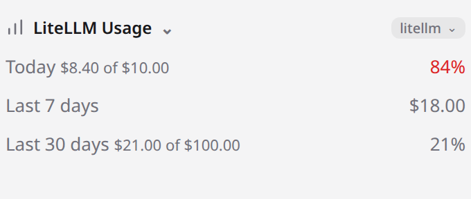

# <picture><source media="(prefers-color-scheme: dark)" srcset="icon-dark.svg"></picture> LiteLLM Usage for OpenChamber

An [OpenChamber](https://openchamber.dev) extension that shows your self-hosted
[LiteLLM](https://docs.litellm.ai) proxy's spend inside the chat's **Work
Status** panel — the same panel that lists Context, Project, Usage, Turn stats,
MCP and other sections. One section, no rail panel, no toolbar icon.

<picture>
  <source media="(prefers-color-scheme: dark)" srcset="docs/images/litellm-usage-dark.png">
  
</picture>

## Features

- **Rolling spend** — today, the last 7 days and the last 30 days, each totalled
  over your local calendar days.
- **Quota usage** — when the key has its own budget windows, each matching row
  also shows the percentage used and the window's spend and cap, e.g.
  `Today  $8.40 of $10.00  84%`. The 50% / 80% tone matches OpenChamber's own
  Usage section.
- **Pick your proxy** — when more than one LiteLLM target is discovered, a
  select beside the section title chooses the one to monitor. The choice is
  remembered.
- **Zero configuration** — the proxy's URL and key are read from the OpenCode
  provider you already use, so there is nothing to paste.
- **Read-only** — the extension only ever reads; it never writes to LiteLLM.

> **Key windows only.** The section shows the key's own daily/weekly/monthly
> budget windows. Team and member budgets, remaining budget, reset dates, soft
> budgets and per-model or TPM/RPM limits are not shown.

## Install

The extension needs OpenChamber **2.0 or newer**. In OpenChamber, open
**Settings → Extensions**, paste this repository's URL into **Folder, ZIP, or
URL**, and choose **Add**:

```
https://github.com/oroszgy/openchamber-litellm-usage
```

Approve the extension and **allow its local service**. A **LiteLLM Usage**
section then joins Work Status. Installed from a git URL, the extension updates
itself: when the version bumps, the card offers **Update**. Add a release tag to
the URL to pin one, for example `#v0.4.0`.

The built bundles (`status/main.js`, `service/main.js`) ship in the repository,
because OpenChamber never compiles an extension. To run a checkout instead, build
it and install the folder — see [Development](#development).

## How it finds your proxy

There is no credential form. The extension reads the proxy **base URL** and
**virtual key** from OpenCode's own configuration, so a user who already calls
the proxy from OpenCode — including one added through OpenChamber's provider UI —
gets the section working with no new input.

- It scans OpenCode's config as `.json` **and** `.jsonc`, in OpenCode's own
  precedence — the global `~/.config/opencode/opencode.json(c)` (or
  `$OPENCODE_CONFIG_DIR`), then the project's `opencode.json(c)` and
  `.opencode/opencode.json(c)`, then `$OPENCODE_CONFIG` (else OpenChamber's
  managed copy). The same provider id in a later source wins.
- A **candidate** is any provider with a `baseURL`, whatever its name. Its URL is
  that `baseURL` with a trailing `/v1` removed (the management root); its key is
  the entry's inline `apiKey` — with `{env:NAME}` and `{file:path}` references
  resolved — falling back to OpenCode's credential store
  `~/.local/share/opencode/auth.json`.
- A candidate is used only if a **probe** (`GET /key/info`) confirms it is a
  LiteLLM proxy. The name is not trusted: a provider typo'd as `litelm` is still
  found. Unconfirmed candidates stay out of the section; the service logs why.
- With several confirmed candidates, pick one in the select beside the section
  title (on a host that advertises header controls; older hosts use the
  default). With one, it is used directly. With none, the section points at
  OpenCode's provider config.

A virtual key reads only itself, which is all this extension needs; no master key
is involved.

## How spend is read

- **Rolling spend** comes from `GET /user/daily/activity`, bucketed in the
  service over local calendar days. The endpoint pages at roughly 15 days and
  can split one day across pages, so the service reads every page and sums the
  buckets by date.
- **Quota usage** comes from the key's own `GET /key/info`: the legacy
  `max_budget` + `budget_duration` window, and the multi-window `budget_limits`
  paired with `budget_limits_usage`. `24h`/`1d` maps to today, `7d` to the last
  7 days, `30d`/`1mo` to the last 30 days. A `max_budget` with no duration is a
  separate `Total` row. Other durations, such as 5 hours, are not shown.
- The key's `total_spend` is never read: LiteLLM does not backfill it, and it
  can disagree with the key's own `spend`.

## Security

- **The key stays with the service, not the page.** The sandboxed section never
  receives the proxy key. A host-spawned local service reads the config, attaches
  the key to each LiteLLM request, and returns only normalised figures.
- **The service is local.** It binds loopback and requires the host-issued bearer
  on **every** route (including `/health`), so nothing else on the machine can
  use it as an open relay.
- **It reads another application's credential file at rest** — OpenCode's config,
  or `auth.json` for a key kept out of the config. This does not widen the local
  trust boundary: any process running as you can already read those files.
- **Read-only.** The extension makes no LiteLLM writes.

## Limitations

- **Key windows only.** A key governed by a team or member budget shows its own
  spend and windows, but not the binding team/member quota.
- **One key at a time.** The picker chooses one proxy; it does not aggregate
  several.
- **No reset dates or remaining budget.** The section shows spend and used
  percentage, not when a window resets or how much is left.
- **Read on demand.** The section reads when it is shown and expanded, and
  refreshes when the session or project changes; it does not poll on a timer and
  has no manual refresh button.
- **No history.** Only today, the last 7 days and the last 30 days are shown.

## Development

Development requires **[Bun](https://bun.sh) ≥ 1.4**. The exact version is pinned
in `packageManager` (`bun@1.4.0`): the committed bundles are produced by Bun's
bundler, whose output can change between releases, so the same version must
generate them.

```sh
bun install
bun run build    # regenerates the committed status/main.js and service/main.js
bun run check    # typecheck + build + tests
bun test
```

The two bundles are generated by `bun run build` and committed, so the extension
installs straight from the repository URL. A source change must regenerate and
commit them; never hand-edit them. To iterate, point **Settings → Extensions** at
this folder once, then rebuild and reload the section after each change.

The local service is a **long-lived process**, so reloading the section does not
reload it. After a change under `service/`, rebuild and then disable and re-enable
the extension (or restart OpenChamber); otherwise the section keeps talking to the
old service.

## License

[MIT](LICENSE) © 2026 György Orosz.
