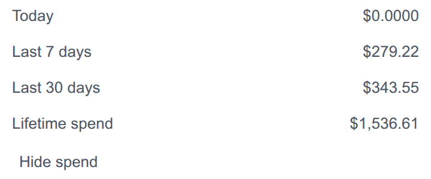

# <picture><source media="(prefers-color-scheme: dark)" srcset="icon.svg"></picture> LiteLLM Usage for OpenChamber

An [OpenChamber](https://openchamber.dev) extension that shows your self-hosted
[LiteLLM](https://docs.litellm.ai) proxy's spend inside the chat's **Work
Status** panel — the same panel that lists Context, Project, Usage, Turn stats,
MCP and other sections. One section, no rail panel, no toolbar icon.



## Features

- **Rolling spend** — today, the last 7 days and the last 30 days, each totalled
  over your local calendar days, always visible.
- **Spend behind a toggle** — the key's spend figure is hidden until you ask for
  it, and the choice is remembered per server. It reads **Lifetime spend** on an
  unbudgeted key, **Spend** when the key has a budget window.
- **Zero configuration** — the proxy's URL and key are read from the OpenCode
  provider you already use, so there is nothing to paste.
- **Read-only** — the extension only ever reads; it never writes to LiteLLM.

> **Not yet shown.** The design in
> [#12](https://github.com/oroszgy/openchamber-litellm-usage/issues/12) adds
> per-budget **remaining** figures and reset windows (key, member and team).
> This release shows spend only.

## Install

The extension needs OpenChamber **2.0 or newer**. In OpenChamber, open
**Settings → Extensions**, paste this repository's URL into **Folder, ZIP, or
URL**, and choose **Add**:

```
https://github.com/oroszgy/openchamber-litellm-usage
```

Approve the extension and **allow its local service**. A **LiteLLM Usage**
section then joins Work Status. Installed from a git URL, the extension updates
itself: when the version bumps, the card offers **Update**. Add a release tag to
the URL to pin one, for example `#v0.2.0`.

The built bundles (`status/main.js`, `service/main.js`) ship in the repository,
because OpenChamber never compiles an extension. To run a checkout instead, build
it and install the folder — see [Development](#development).

## How it finds your proxy

There is no credential form. The extension reads the proxy **base URL** and
**virtual key** from OpenCode's own configuration, so a user who already calls
the proxy from OpenCode gets the section working with no new input.

- It scans OpenCode's config as `.json` **and** `.jsonc`, in precedence order —
  the open project's `<directory>/opencode.json(c)`, then the global
  `~/.config/opencode/opencode.json(c)`, then OpenChamber's managed copy. The
  same provider id in a more specific source wins.
- A candidate is a provider whose **id or display name contains `litellm`**
  (case-insensitive). Its URL is the provider's `baseURL` with a trailing `/v1`
  removed (the management root); its key is the entry's inline `apiKey`, falling
  back to OpenCode's credential store `~/.local/share/opencode/auth.json`.
- With several candidates, the one nearest the string `litellm` is used. When
  none is found, the section shows a one-line hint pointing at the config.

A virtual key reads only itself, which is all this extension needs; no master key
is involved.

## Security

- **The key stays with the service, not the page.** The sandboxed section never
  receives the proxy key. A host-spawned local service reads the config, attaches
  the key to each LiteLLM request, and returns only normalised figures.
- **The service is local.** It binds loopback and requires the host-issued bearer
  on **every** route (including `/health`), so nothing else on the machine can
  use it as an open relay.
- **It reads another application's credential file at rest** — OpenCode's config,
  or `auth.json` for a key kept out of the config. This does not widen the local
  trust boundary: any process running as you can already read those files.
- **Read-only.** The extension makes no LiteLLM writes.

## Limitations

- **Spend only.** Remaining budget and reset windows are not shown yet; that is
  the [budget design](https://github.com/oroszgy/openchamber-litellm-usage/issues/12).
- **One proxy, chosen for you.** The candidate nearest `litellm` is used; a
  provider selector is not built yet.
- **Read on demand.** The section reads when it is shown and expanded; it does
  not poll in the background.

## Development

Development requires **[Bun](https://bun.sh) ≥ 1.4**. The exact version is pinned
in `packageManager` (`bun@1.4.0`): the committed bundles are produced by Bun's
bundler, whose output can change between releases, so the same version must
generate them.

```sh
bun install
bun run build    # regenerates the committed status/main.js and service/main.js
bun run check    # typecheck + build + tests
bun test
```

The two bundles are generated by `bun run build` and committed, so the extension
installs straight from the repository URL. A source change must regenerate and
commit them; never hand-edit them. To iterate, point **Settings → Extensions** at
this folder once, then rebuild and reload the section after each change.

The local service is a **long-lived process**, so reloading the section does not
reload it. After a change under `service/`, rebuild and then disable and re-enable
the extension (or restart OpenChamber); otherwise the section keeps talking to the
old service.

## License

[MIT](LICENSE) © 2026 György Orosz.
